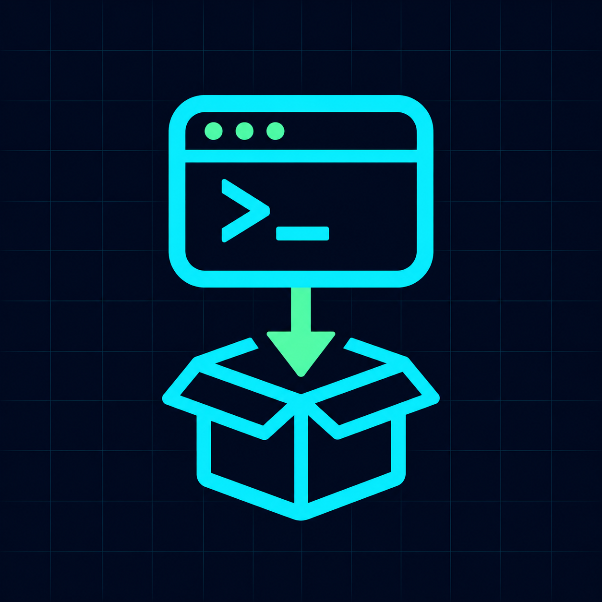
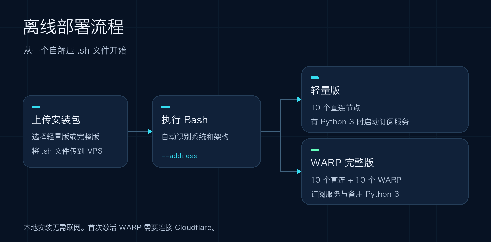

<p align="center">
  
</p>

<h1 align="center">fangqiang_oneclick</h1>

<p align="center">面向小型 Debian / Ubuntu VPS 的 sing-box 离线部署说明</p>

项目记录两种自解压 `.sh` 安装包的用法和实测结果。将手中的安装包上传到 VPS，运行一条 Bash 命令即可在本地解包、生成配置并启动服务。



## 安装包

| 版本 | 文件 | 大小 | 部署内容 |
| --- | --- | ---: | --- |
| 轻量版 | [下载轻量版 .sh](../../releases/download/v2026.11.24/sing-box-plus-offline-lite-universal.sh) | 约 46 MiB | 10 个直连节点。有可用的系统 Python 3 时启动订阅服务 |
| WARP 完整版 | [下载 WARP 完整版 .sh](../../releases/download/v2026.11.24/sing-box-plus-offline-warp-universal.sh) | 约 247 MiB | 10 个直连节点和 10 个 WARP 节点。内置备用 Python 3 |

两个包自动识别 `x86_64`（amd64）或 `aarch64`（arm64），支持 Debian 11/12/13 和 Ubuntu 22.04/24.04，需在运行 systemd 的服务器上以 root 或 sudo 安装。

发行说明和附件集中在 [v2026.11.24 Release](../../releases/tag/v2026.11.24)。

## 安装

将其中一个 `.sh` 上传到 VPS，在文件所在目录执行对应命令。把 `SERVER_IP_OR_DOMAIN` 替换为实际公网 IP 或域名。

```bash
# 轻量版
sudo bash sing-box-plus-offline-lite-universal.sh --address SERVER_IP_OR_DOMAIN

# 完整版，安装后接着激活 WARP
sudo bash sing-box-plus-offline-warp-universal.sh --address SERVER_IP_OR_DOMAIN --activate-warp
```

完整版可先离线部署。首次激活 WARP 需要 VPS 能连接 Cloudflare，按提示输入 `yes` 表示同意使用条款，脚本随后检查 HTTPS 请求是否确实经 WARP 出站。 [Cloudflare 应用使用条款](https://www.cloudflare.com/application/terms/)

安装后运行 `sudo singbox-offline`，选择菜单 `2` 查看节点和订阅。订阅链接含有访问令牌，复制到自己的客户端即可。

## 校验与实测

- 下载 [SHA256SUMS](../../releases/download/v2026.11.24/SHA256SUMS)，在同一目录运行 `sha256sum --ignore-missing -c SHA256SUMS` 核对已下载的安装包。也可运行 `bash 安装包文件名.sh --verify` 检查包内文件。
- 两版都在断网的 Debian 11（amd64、arm64）和 Debian 12（amd64）虚拟机中通过全新安装、端口监听和订阅认证测试。
- 测试覆盖默认订阅端口已被占用、轻量版保留密钥和订阅升级到完整版，以及缺少系统 Python 和 OpenSSL 时使用完整版内置组件。
- Debian 11 使用兼容 glibc 2.31 的 WARP 构建。Debian 13 与 Ubuntu 两个版本属于安装器支持范围，实装测试覆盖上述三种 Debian 环境。 [Cloudflare Linux 软件包](https://pkg.cloudflareclient.com/)

## 上游来源

部署脚本参考 [Gavin-gitsky/Sing-Box-Plus](https://github.com/Gavin-gitsky/Sing-Box-Plus)，代理核心来自 [SagerNet/sing-box](https://github.com/SagerNet/sing-box)。Cloudflare WARP 客户端的版本、使用条款和下载由 [Cloudflare 官方软件源](https://pkg.cloudflareclient.com/) 提供。

本项目为独立部署记录。第三方组件遵循各自条款。
